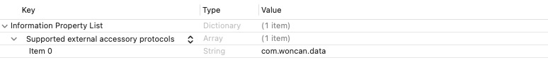
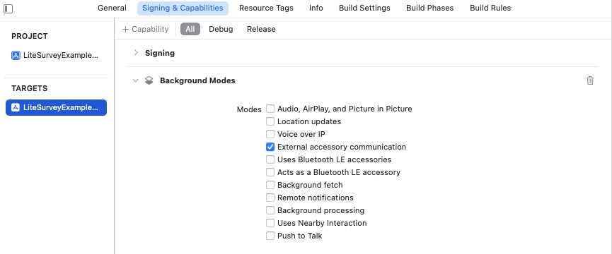

# LiteSurvey SDK Demo for iOS

This demo project shows how to use the LiteSurvey SDK to connect to Woncan LiteSurvey devices.

LiteSurvey SDK for iOS can connect to LiteSurvey devices and

- Output device data (location, satellite, etc.) to the application
- Configure device settings
- Perform device firmware upgrade
- and more

By integrating this SDK, you can support LiteSurvey device's high-accuracy position in your own app.

This SDK is also used in Woncan's official iOS app, LiteSurvey Pro.

## iOS system requirement

iOS 13.0 or above is required.

## How to use the SDK in your own app

### 1. Adding LiteSurvey as a dependency

**Method 1:  Swift Package Manager (Preferred)**

1.  Follow the instructions for
    [adding package dependencies to your app in Xcode](https://developer.apple.com/documentation/xcode/adding-package-dependencies-to-your-app).

2.  In the "Enter Package URL" field, enter this GitHub repository:

    ```
    https://github.com/WoncanHK/LiteSurveySDK-iOS
    ```

3.  Select the version of the LiteSurveySDK for iOS that you want to use. For new projects, we recommend specifying the latest version and using the "Exact Version" option.

**Method 2: Manual integration**

If you prefer not to use Swift Package Manager, you can integrate LiteSurvey into your project manually. The SDK framework file is available under "Releases".

You will need to Embed & Sign the LiteSurvey framework in the target settings of your app.

### 2. Configure info.plist

Add "com.woncan.data" as a supported external accessory protocol:



If device connection in background mode is desired, you may optionally add the "External accessory communication" Background mode under "Signing and Capabilities".



### 3. Import LiteSurvey in Your Swift / Objective-C Project

LiteSurvey SDK is written in Swift. For Swift projects, add `import LiteSurvey` to the top of your Swift file. For Objective-C projects, add `#import <LiteSurvey/LiteSurvey.h>`.

### 4. Scanning for devices

Use the `LiteSurveyDeviceScanner.shared.startScan` method to start scanning.

#### EA picker and Scene compatibility

In a Scene-based iOS app, a scan that presents Apple's External Accessory (EA) Bluetooth picker may reach the system without displaying the picker. In LiteSurvey Pro, we observed the app's main window already belonged to an active Scene, while the newly created picker window had no `windowScene`. Associating that window with the host Scene made the picker visible in our tests. Other causes can also prevent a picker from appearing.

The following is the **App-side approach used in our LiteSurvey Pro test build**; it does not change the SDK or Apple's APIs:

1. On the main thread, after Bluetooth permission is granted and immediately before starting an EA picker scan, capture the initiating app window and its Scene. Record existing Scene windows and start a short-lived observer for [`UIWindow.didBecomeVisibleNotification`](https://developer.apple.com/documentation/uikit/uiwindow/didbecomevisiblenotification).
2. Consider only a newly visible, non-host window with a root view controller and a window level one point above `UIWindow.Level.alert`. Our implementation treats these properties as a heuristic and proceeds only when exactly one candidate has been observed. They are **not** an official EA window identifier.
3. On the next main-queue turn, recheck that the same host Scene is foreground active and the candidate is still visible and has no Scene. If the candidate already belongs to any Scene, or the selection is ambiguous, leave it unchanged. For a valid candidate, remove the observer, set its [`windowScene`](https://developer.apple.com/documentation/uikit/uiwindow/windowscene) to the host Scene, and call `makeKeyAndVisible()` once. The following illustrates only that final operation; it is not a complete observer:

   ```swift
   // Only after the checks above pass and the observer has been removed.
   pickerWindow.windowScene = hostScene
   pickerWindow.makeKeyAndVisible()
   ```

4. End observation as soon as the window is handled, or when the request ends, the app enters the background, the Scene disconnects, or the 15-second observation limit expires. Ending observation does not cancel the SDK scan or imply that an accessory connected. The implementation isolates consecutive requests so delayed work from an earlier scan cannot modify a later one.

The app uses its registered main window to identify the host Scene, and does not apply a hard-coded iOS version cutoff. Integrators should validate the window-selection rules and lifecycle in their own app, particularly if they support multiple Scenes or show other system windows during a scan. Window properties and notification timing can change across iOS versions.

We verified the following with the same LiteSurvey Pro **2.0.3 (3) Debug** test build, using the app's internal SDK integration (native SDK 1.0.59). This was not a separate test of a release of the binary SDK in this repository:

| Test device | System | Two searches and cancellations | App-side Scene repairs |
| --- | --- | --- | --- |
| iPhone 14 Pro | iOS 17.1.1 | Passed | One per search |
| iPad 10 | iPadOS 18.7.8 | Passed | One per search |
| iPhone 14 Pro | iOS 27.2 | Passed | None; the picker was already associated with the host Scene |

These checks covered picker presentation, cancellation, and repeated search; actual accessory pairing and data reception were not tested. They do not establish a universal affected-version range or a fixed iOS version boundary. Apple's [`showBluetoothAccessoryPicker`](https://developer.apple.com/documentation/externalaccessory/eaaccessorymanager/showbluetoothaccessorypicker%28withnamefilter%3Acompletion%3A%29) documentation does not describe this specific Scene behavior. Other developers have reported a similar symptom in the [Apple Developer Forums](https://developer.apple.com/forums/thread/690320).

### 5. Receive device data (e.g. location)

When connecting to a device, register a delegate implementing the `LiteSurveyDeviceDelegate` interface to receive device data.

### Code example

The following code snippet is a minimal code example in Swift that

1. Scans for nearby LiteSurvey devices.
2. After connection, prints the location information reported by the device to debug output.

```Swift
class ViewController: UIViewController, LiteSurveyDeviceDelegate {
    
  override func viewDidLoad() {
        super.viewDidLoad()
  }

    //Scanning for LiteSurvey devices
    public func scan() {
        LiteSurveyDeviceScanner.shared.startScan(delegate: self)
    }

    // Receive Location delegate
    func didReceiveLocation(_ location: LiteSurveyLocationModel!) {
        print(location!)
    }
}
```

## Location information reported by the SDK

Location information is reported as the `LiteSurveyLocationModel` class. This class inherits from the system Location class [ `CLLocation`](https://developer.apple.com/documentation/corelocation/cllocation?language=objc#). Please see `LiteSurveyLocationModel` class definition for details.

Table: LiteSurvey SDK support for system `CLLocation` class parameters

|      Parameter      | Supported by LiteSurvey | Note                                          |
| :-----------------: | ----------------------- | --------------------------------------------- |
|     coordinate      | Yes                     |                                               |
|      altitude       | Yes                     |                                               |
| ellipsoidalAltitude | No                      | Use the custom property wgs84Altitude instead |
| horizontalAccuracy  | Yes                     |                                               |
|  verticalAccuracy   | Yes                     |                                               |
|       course        | Yes                     |                                               |
|   courseAccuracy    | No                      |                                               |
|        speed        | Yes                     |                                               |
|    speedAccuracy    | No                      |                                               |
|      timestamp      | Yes                     |                                               |
|        floor        | No                      |                                               |
|  sourceInformation  | Yes                     |                                               |

## Contact email

For technical or business inquiries, please contact support@woncan.com.hk
